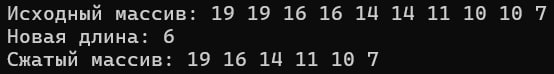
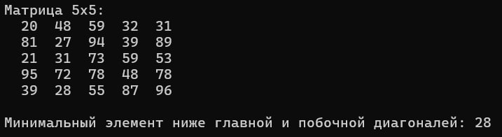

# Контрольная работа №1

## Навигация по заданиям

 1. [Сжатие массива](#задание-1-сжатие-массива-без-дубликатов) | [`2026-11-17_task01.cpp`](./src/2026-11-17_task01.cpp) 
 2. [Минимум под диагоналями матрицы](#задание-2-минимум-под-диагоналями-матрицы) | [`2026-11-17_task02.cpp`](./src/2026-11-17_task02.cpp) 

---

## Задание 1. Сжатие массива без дубликатов

### 1. Постановка задачи
Написать функцию, которая принимает указатель на массив, отсортированный по невозрастанию, и удаляет из него все повторы чисел. Дополнительный массив создавать запрещено — вся перезапись должна происходить внутри исходного массива.

> **Примечание:** Для удобства демонстрации выбран размер массива из 10 элементов со случайными числами.

### 2. Подход к решению
- В функцию `compressArray` передаются указатель на начало массива `int* arr` и его длина `n`.
- Создается индекс `k = 1`, указывающий позицию для записи следующего уникального элемента.
- Цикл `for` проходит по элементам от 1 до `n - 1`. Если текущее число `arr[i]` не равно последнему записанному `arr[k - 1]`, оно записывается в ячейку `arr[k]`, а индекс `k` увеличивается.
- Функция возвращает `k` — новую длину сжатого массива.

### 3. Исходный код
Файл с решением: [`2026-11-17_task01.cpp`](./src/2026-11-17_task01.cpp)

### 4. Демонстрация работы

Тест 1 (Массив с повторяющимися числами). Исходный массив содержит дубликаты, программа сжимает его на месте и возвращает новую длину:

---

## Задание 2. Минимум под диагоналями матрицы

### 1. Постановка задачи
Написать функцию для поиска минимального числа среди элементов квадратной матрицы, которые лежат строго ниже главной и строго ниже побочной диагонали одновременно (нижний сектор матрицы). Указатель на матрицу и ее размерность передать в качестве параметров.

> **Примечание:** Для наглядности выбрана матрица 5х5, заполненная случайными числами от 10 до 99.

### 2. Подход к решению
- Матрица передается в функцию через указатель на ее первый элемент `int* mat` вместе с размером `n`. Для обращения к ячейке `[i][j]` используется одномерный сдвиг: `mat[i * n + j]`.
- Вложенными циклами перебираются все строки и столбцы.
- Условие попадания в нижний сектор проверяется выражением:
  - `i > j` (строго ниже главной диагонали);
  - `i + j > n - 1` (строго ниже побочной диагонали).
- Среди элементов, подошедших под оба условия, находится минимум с помощью переменной `minVal` и флага первого нахождения `found`.

### 3. Исходный код
Файл с решением: [`2026-11-17_task02.cpp`](./src/2026-11-17_task02.cpp)

### 4. Демонстрация работы

Тест 1 (Поиск минимума в матрице 5х5). Программа выводит сгенерированную матрицу в виде таблицы и находит наименьшее число в нижнем треугольнике:

