# Лабораторная работа №1: Базовые алгоритмы, циклы и ветвления

## Навигация по заданиям

| № | Название задания | Файл решения |
|---|---|---|
| 1 | [Вычисление факториала](#задание-1-вычисление-факториала) | [`task01.cpp`](./src/task01.cpp) |
| 2 | [Нахождение НОД и НОК](#задание-2-нахождение-нод-и-нок) | [`task02.cpp`](./src/task02.cpp) |
| 3 | [Сумма цифр числа](#задание-3-сумма-цифр-числа) | [`task03.cpp`](./src/task03.cpp) |
| 4 | [Решение квадратного уравнения](#задание-4-решение-квадратного-уравнения) | [`task04.cpp`](./src/task04.cpp) |
| 5 | [Проверка числа на простоту](#задание-5-проверка-числа-на-простоту) | [`task05.cpp`](./src/task05.cpp) |
| 6 | [Числовой палиндром](#задание-6-числовой-палиндром) | [`task06.cpp`](./src/task06.cpp) |
| 7 | [Возведение в степень](#задание-7-возведение-в-степень) | [`task07.cpp`](./src/task07.cpp) |
| 8 | [Подсчет уникальных цифр](#задание-8-подсчет-уникальных-цифр) | [`task08.cpp`](./src/task08.cpp) |
| 9 | [Построение прямоугольной трапеции](#задание-9-построение-прямоугольной-трапеции) | [`task09.cpp`](./src/task09.cpp) |
| 10 | [Простые делители числа](#задание-10-простые-делители-числа) | [`task10.cpp`](./src/task10.cpp) |
| 11 | [Числа Фибоначчи](#задание-11-числа-фибоначчи) | [`task11.cpp`](./src/task11.cpp) |

---

## Задание 1. Вычисление факториала

### 1. Постановка задачи
Ввести целое число $n$ и посчитать его факториал. Если введено отрицательное число — вывести сообщение об ошибке.

### 2. Подход к решению
- Если число меньше нуля, выводится сообщение об ошибке и выполнение прекращается.
- Для факториала используется тип `long long` со значением 1 для защиты от быстрого переполнения типа `int`.
- Циклом `for` от 1 до $n$ последовательно перемножаются числа.

### 3. Исходный код
Файл с решением: [`task01.cpp`](./src/task01.cpp)

### 4. Демонстрация работы

Тест 1 (Корректное число). Вводим 5, получаем результат factorial = 120:

Тест 2 (Отрицательное число). Вводим -3, возникает ошибка:

---

## Задание 2. Нахождение НОД и НОК

### 1. Постановка задачи
Ввести два натуральных числа $a$ и $b$. Найти их наибольший общий делитель (НОД) и наименьшее общее кратное (НОК).

### 2. Подход к решению
- Числа проверяются на строго положительные значения ($a > 0, b > 0$).
- НОД находится по алгоритму Евклида делением с остатком в цикле `while`.
- НОК вычисляется по формуле: $(a \cdot b) / \text{НОД}$. Произведение приведено к `long long` во избежание переполнения.

### 3. Исходный код
Файл с решением: [`task02.cpp`](./src/task02.cpp)

### 4. Демонстрация работы

Тест 1. Вводим 12 и 18, программа вычисляет NOD = 6 и NOK = 36:

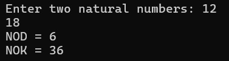

Тест 2 (Некорректный ввод). Вводим 0 и 5, программа выводит ошибку:

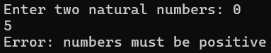

---

## Задание 3. Сумма цифр числа

### 1. Постановка задачи
Ввести целое число и найти сумму всех цифр, из которых оно состоит.

### 2. Подход к решению
- Отрицательное число берется по модулю (умножением на -1).
- В цикле `while (n > 0)` младший разряд извлекается операцией `n % 10` и суммируется, после чего число уменьшается операцией `n / 10`.

### 3. Исходный код
Файл с решением: [`task03.cpp`](./src/task03.cpp)

### 4. Демонстрация работы

Тест 1. Вводим 12345, получаем Sum = 15:

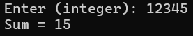

Тест 2 (Отрицательное число). Вводим -805, получаем Sum = 13:

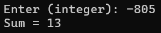

---

## Задание 4. Решение квадратного уравнения

### 1. Постановка задачи
Найти корни уравнения $ax^2 + bx + c = 0$. Обработать случаи вырождения в линейное уравнение, отсутствие корней и бесконечное множество решений.

### 2. Подход к решению
- Если $a = 0$, уравнение рассматривается как линейное: при $b = 0$ и $c = 0$ решений бесконечно много, при $b = 0, c \neq 0$ решений нет, иначе корень $x = -c / b$.
- Если $a \neq 0$, вычисляется дискриминант $D = b^2 - 4ac$:
  - $D > 0$ — два корня;
  - $D = 0$ — один корень;
  - $D < 0$ — действительных корней нет.

### 3. Исходный код
Файл с решением: [`task04.cpp`](./src/task04.cpp)

### 4. Демонстрация работы

Тест 1 (Два корня, $D > 0$). Вводим 1, -5, 6. Корни x1 = 2, x2 = 3:

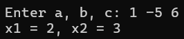

Тест 2 (Один корень, $D = 0$). Вводим 1, -4, 4. Корень x = 2:

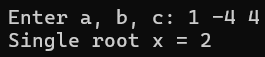

Тест 3 (Нет корней, $D < 0$). Вводим 1, 2, 5. Действительных корней нет:

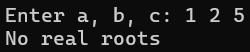

Тест 4 (Линейный случай, $a = 0$). Вводим 0, 2, -6. Корень x = 3:

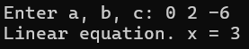

---

## Задание 5. Проверка числа на простоту

### 1. Постановка задачи
Определить, является ли введенное натуральное число $n$ простым.

### 2. Подход к решению
- Числа $n \le 1$ сразу отсекаются как непростые.
- Проверка делителей выполняется в цикле от 2 с оптимизацией до корня из числа (`i * i <= n`).
- При нахождении первого же делителя флаг переключается в `false`, цикл досрочно прерывается через `break`.

### 3. Исходный код
Файл с решением: [`task05.cpp`](./src/task05.cpp)

### 4. Демонстрация работы

Тест 1 (Простое число). Вводим 17, получаем Prime:

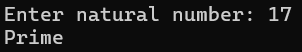

Тест 2 (Составное число). Вводим 18, получаем Not prime:

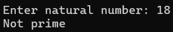

---

## Задание 6. Числовой палиндром

### 1. Постановка задачи
Проверить, читается ли введенное целое число одинаково слева направо и справа налево.

### 2. Подход к решению
- Отрицательные числа приводятся к модулю.
- В цикле `while` формируется число-перевертыш (`reversed = reversed * 10 + n % 10`) в переменной `long long`.
- Результат сравнивается с исходным значением.

### 3. Исходный код
Файл с решением: [`task06.cpp`](./src/task06.cpp)

### 4. Демонстрация работы

Тест 1 (Палиндром). Вводим 12321, получаем Palindrome:

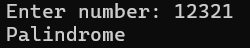

Тест 2 (Не палиндром). Вводим 12345, получаем Not palindrome:

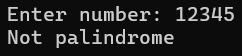

---

## Задание 7. Возведение в степень

### 1. Постановка задачи
Вычислить $x^n$ для вещественных чисел с проверкой недопустимых математических операций.

### 2. Подход к решению
Перед расчетом отсекаются ошибки:
1. $x = 0$ и $n = 0$ — неопределенность $0^0$.
2. $x = 0$ и $n < 0$ — деление на ноль.
3. $x < 0$ и нецелое $n$ — корень из отрицательного числа (проверка `(long long)n != n`).
Если данные корректны, результат вычисляется функцией `std::pow(x, n)`.

### 3. Исходный код
Файл с решением: [`task07.cpp`](./src/task07.cpp)

### 4. Демонстрация работы

Тест 1 (Корректный расчет). Вводим 2 и 10, получаем Result = 1024:

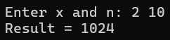

Тест 2 (Неопределенность $0^0$). Вводим 0 и 0, получаем ошибку:

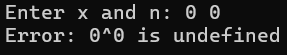

Тест 3 (Деление на ноль). Вводим 0 и -2, получаем ошибку деления:

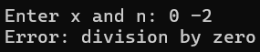

Тест 4 (Дробная степень отрицательного числа). Вводим -4 и 0.5, получаем ошибку:

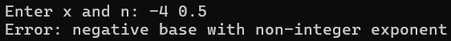

---

## Задание 8. Подсчет уникальных цифр

### 1. Постановка задачи
Посчитать количество неповторяющихся цифр в записи целого числа.

### 2. Подход к решению
- Число берется по модулю.
- Внешний цикл перебирает цифры от 0 до 9.
- Внутренний цикл делением на 10 сканирует разряды числа на совпадение с текущей цифрой. При нахождении счетчик увеличивается на 1. Ноль обрабатывается отдельно.

### 3. Исходный код
Файл с решением: [`task08.cpp`](./src/task08.cpp)

### 4. Демонстрация работы

Тест 1. Вводим 1122334, получаем Distinct digits = 4:

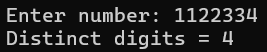

Тест 2. Вводим 0, получаем Distinct digits = 1:

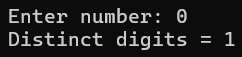

---

## Задание 9. Построение прямоугольной трапеции

### 1. Постановка задачи
Вывести прямоугольную трапецию из символов `*`. Пользователь задает верхнее основание $L$ и высоту $N$. Каждая следующая строка увеличивается на 1 символ.

### 2. Подход к решению
- Проверяется положительность параметров ($L > 0, N > 0$).
- Внешний цикл отсчитывает $N$ строк, внутренний цикл печатает $L + i$ символов в строке с переводом строки `\n`.

### 3. Исходный код
Файл с решением: [`task09.cpp`](./src/task09.cpp)

### 4. Демонстрация работы

Тест 1 (Построение). Вводим L = 3 и N = 4, выводятся строки длиной 3, 4, 5, 6:

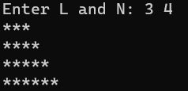

Тест 2 (Отрицательные размеры). Вводим -2 и 3, программа сообщает об ошибке:

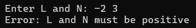

---

## Задание 10. Простые делители числа

### 1. Постановка задачи
Вывести все простые делители натурального числа без повторений.

### 2. Подход к решению
- Числа $\le 1$ отсекаются.
- Цикл перебирает возможные делители $d$ от 2 до $n$.
- Если $n$ делится на $d$, число $d$ выводится, а затем внутренним циклом `while (n % d == 0)` делитель вычищается из $n$ для исключения дубликатов.

### 3. Исходный код
Файл с решением: [`task10.cpp`](./src/task10.cpp)

### 4. Демонстрация работы

Тест 1. Вводим 60, программа выводит 2 3 5:

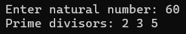

Тест 2. Вводим простое число 13, программа выводит 13:

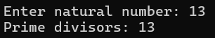

---

## Задание 11. Числа Фибоначчи

### 1. Постановка задачи
Вывести первые $k$ чисел ряда Фибоначчи.

### 2. Подход к решению
- Проверяется условие $k > 0$.
- Первые члены $a = 0, b = 1$ объявлены типом `long long`.
- В цикле от 0 до $k - 1$ текущее значение $a$ выводится, после чего значения сдвигаются через сумму без использования массивов.

### 3. Исходный код
Файл с решением: [`task11.cpp`](./src/task11.cpp)

### 4. Демонстрация работы

Тест 1. Вводим 7, программа выводит Fibonacci: 0 1 1 2 3 5 8:

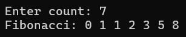

Тест 2 (Ошибочный ввод). Вводим 0, программа выводит сообщение об ошибке:

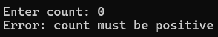
