# Лабораторная работа №1: Базовые алгоритмы, циклы и ветвления

## Навигация по заданиям 

1. [Вычисление факториала](#задание-1-вычисление-факториала)  | [`task01.cpp`](./src/task01.cpp)
2. [Нахождение НОД и НОК](#задание-2-нахождение-нод-и-нок) |  [`task02.cpp`](./src/task02.cpp)
3. [Сумма цифр числа](#задание-3-сумма-цифр-числа) |  [`task03.cpp`](./src/task03.cpp)
4. [Решение квадратного уравнения](#задание-4-решение-квадратного-уравнения) |  [`task04.cpp`](./src/task04.cpp)
5. [Проверка числа на простоту](#задание-5-проверка-числа-на-простоту) |  [`task05.cpp`](./src/task05.cpp)
6. [Числовой палиндром](#задание-6-числовой-палиндром) |  [`task06.cpp`](./src/task06.cpp)
7. [Возведение в степень](#задание-7-возведение-в-степень) |  [`task07.cpp`](./src/task07.cpp)
8. [Подсчёт уникальных цифр](#задание-8-подсчет-уникальных-цифр) |  [`task08.cpp`](./src/task08.cpp)
9. [Вывод трапеции](#задание-9-построение-прямоугольной-трапеции) |  [`task09.cpp`](./src/task09.cpp)
11. [Простые делители числа](#задание-10-простые-делители-числа) |  [`task10.cpp`](./src/task10.cpp)
12. [Последовательность Фибоначчи](#задание-11-числа-фибоначчи) |  [`task11.cpp`](./src/task11.cpp)

---

## Задание 1. Вычисление факториала

### Условие: Разработать программу для вычисления факториала неотрицательного целого числа

### Подход к решению

- Сначала проверяем: если число меньше нуля, выводим сообщение об ошибке и завершаем программу.
- Создаем переменную для ответа и ставим ее равной 1. Используем тип `long long`, потому что факториал растет очень быстро и обычный `int` быстро переполнится.
- Обычным циклом `for` проходим от *1* до *n* и перемножаем числа.

### Решение 

Файл с решением: [`task01.cpp`](./src/task01.cpp)

### Демонстрация работы программы

Вводим положительное число. Получаем результат:

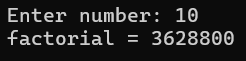

Вводим отрицательное число. Возникает ошибка:

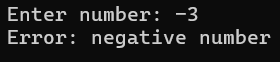

---

## Задание 2. Нахождение НОД и НОК

### 1. Постановка задачи
Ввести два натуральных числа *a* и *b*. Найти их наибольший общий делитель (НОД) и наименьшее общее кратное (НОК).

### 2. Подход к решению
- Проверяем, чтобы оба введенных числа были строго больше нуля.
- НОД находим по алгоритму Евклида через остаток от деления в цикле while: пока второе число не станет нулем, делим первое на второе с остатком и меняем их местами.
- НОК вычисляем по формуле: умножаем a на b и делим на найденный НОД. Чтобы при умножении не возникло переполнения памяти, приводим произведение к типу long long.

### 3. Исходный код
Файл с кодом: [`task02.cpp`](./src/task02.cpp)

### 4. Демонстрация работы

Тест 1. Вводим числа 12 и 18, программа вычисляет NOD = 6 и NOK = 36:

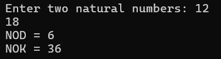

Тест 2 (Некорректный ввод). Вводим числа 0 и 5, программа выводит ошибку:

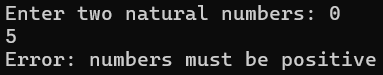

---

## Задание 3. Сумма цифр числа

### 1. Постановка задачи
Ввести целое число (положительное или отрицательное) и найти сумму всех цифр, из которых оно состоит.

### 2. Подход к решению
- Если число отрицательное, убираем знак минус (умножаем на -1), так как цифры числа считаются положительными.
- В цикле while берем последнюю цифру с помощью остатка от деления на 10 (n % 10) и прибавляем ее к переменной суммы.
- Затем убираем эту последнюю цифру делением числа нацело на 10 (n / 10). Цикл работает, пока от числа что-то остается (пока n > 0).

### 3. Исходный код
Файл с кодом: [`task03.cpp`](./src/task03.cpp)

### 4. Демонстрация работы

Тест 1. Вводим число 12345, получаем Sum = 15:

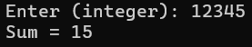

Тест 2 (Отрицательное число). Вводим число -805, получаем Sum = 13:

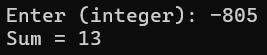

---

## Задание 4. Решение квадратного уравнения

### 1. Постановка задачи
Найти корни уравнения a*x^2 + b*x + c = 0 по введенным коэффициентам a, b и c. Корректно обработать случаи, когда уравнение становится линейным, не имеет корней или имеет бесконечно много решений.

### 2. Подход к решению
- Сначала проверяем коэффициент a. Если a равно 0, то уравнение превращается в линейное (b*x + c = 0):
  - Если при этом и b равно 0, то при c = 0 решений бесконечно много, а при c != 0 решений нет.
  - Если b не равно 0, корень один: x = -c / b.
- Если a не равно 0, считаем дискриминант: D = b*b - 4*a*c.
  - Если D > 0 — вычисляем два корня x1 и x2.
  - Если D == 0 — корень один.
  - Если D < 0 — выводим сообщение, что действительных корней нет.

### 3. Исходный код
Файл с кодом: [`task04.cpp`](./src/task04.cpp)

### 4. Демонстрация работы

Тест 1 (Два различных корня, D > 0). Вводим 1, -5, 6. Корни x1 = 2, x2 = 3:

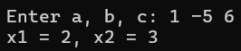

Тест 2 (Один корень, D = 0). Вводим 1, -4, 4. Корень x = 2:

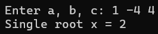

Тест 3 (Нет действительных корней, D < 0). Вводим 1, 2, 5. Действительных корней нет:

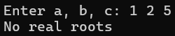

Тест 4 (Вырожденный случай, a = 0). Вводим 0, 2, -6. Линейное уравнение, x = 3:

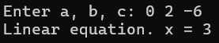

---

## Задание 5. Проверка числа на простоту

### 1. Постановка задачи
Ввести натуральное число *n* и проверить, является ли оно простым (делится только на единицу и само себя).

### 2. Подход к решению
- Числа 1 и меньше сразу отсекаем — они простыми не являются.
- Создаем логическую переменную (флаг), изначально считаем число простым (true).
- Запускаем цикл проверки делителей от 2 до корня из числа (условие i * i <= n, чтобы программа работала быстро).
- Если число n разделилось нацело хотя бы на одно i, значит оно составное — меняем флаг на false и прерываем цикл с помощью break.

### 3. Исходный код
Файл с кодом: [`task05.cpp`](./src/task05.cpp)

### 4. Демонстрация работы

Тест 1 (Простое число). Вводим число 17, получаем ответ Prime:

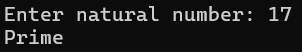

Тест 2 (Составное число). Вводим число 18, получаем ответ Not prime:

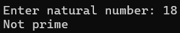

---

## Задание 6. Числовой палиндром

### 1. Постановка задачи
Проверить, читается ли введенное целое число одинаково в обоих направлениях (слева направо и справа налево).

### 2. Подход к решению
- Отрицательные числа берем по модулю (отбрасываем минус).
- Создаем отдельную переменную reversed типа long long со значением 0.
- В цикле while разбираем исходное число: берем последнюю цифру и приписываем ее в конец переменной reversed, умножая предыдущее значение на 10.
- После цикла сравниваем полученный «перевертыш» с исходным числом. Если они равны — число является палиндромом.

### 3. Исходный код
Файл с кодом: [`task06.cpp`](./src/task06.cpp)

### 4. Демонстрация работы

Тест 1 (Палиндром). Вводим число 12321, получаем ответ Palindrome:

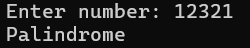

Тест 2 (Обычное число). Вводим число 12345, получаем Not palindrome:

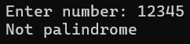

---

## Задание 7. Возведение в степень

### 1. Постановка задачи
Ввести вещественное число x (основание) и вещественное число n (показатель степени). Вычислить результат возведения x в степень n с обязательной проверкой математических ограничений.

### 2. Подход к решению
В математике есть запрещенные операции со степенями. Перед вычислением проверяем 3 ситуации через каскад условий:
1. Если x = 0 и n = 0 — это математическая неопределенность (0 в степени 0). Выводим ошибку.
2. Если x = 0 и n < 0 — это деление на ноль (так как 0 в степени -1 это 1 / 0). Выводим ошибку.
3. Если основание x отрицательное (x < 0), а степень n дробная — это приведет к извлечению корня из отрицательного числа. Проверяем нецелую степень через сравнение с целым типом и выводим ошибку.
4. Если ни одна ошибка не возникла — считаем результат через стандартную функцию std::pow(x, n).

### 3. Исходный код
Файл с кодом: [`task07.cpp`](./src/task07.cpp)

### 4. Демонстрация работы

Тест 1 (Корректное вычисление). Вводим основание 2 и степень 10. Программа выдает Result = 1024:

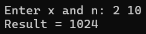

Тест 2 (Неопределенность 0 в степени 0). Вводим x = 0 и n = 0. Программа выводит Error: 0^0 is undefined:

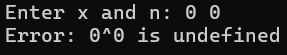

Тест 3 (Деление на ноль). Вводим основание 0 и отрицательную степень -2. Программа выводит Error: division by zero:

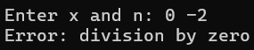

Тест 4 (Отрицательное основание с дробной степенью). Вводим x = -4 и n = 0.5. Программа выводит Error: negative base with non-integer exponent:

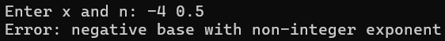

---

## Задание 8. Подсчет уникальных цифр

### 1. Постановка задачи
Посчитать, сколько различных (не повторяющихся) цифр встречается в записи введенного целого числа.

### 2. Подход к решению
- Если число отрицательное, убираем знак минус.
- Делаем внешний цикл по всем 10 возможным цифрам (от 0 до 9).
- Во внутреннем цикле делим число на 10 и проверяем, есть ли текущая цифра среди его разрядов.
- Если цифра встретилась хотя бы один раз, увеличиваем общий счетчик уникальных цифр на 1 и переходим к проверке следующей цифры. Отдельно учитываем случай, если само введенное число равно нулю.

### 3. Исходный код
Файл с кодом: [`task08.cpp`](./src/task08.cpp)

### 4. Демонстрация работы

Тест 1. Вводим число 1122334, программа насчитывает 4 уникальные цифры (Distinct digits = 4):

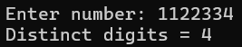

Тест 2. Вводим число 0, программа выводит Distinct digits = 1:

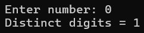

---

## Задание 9. Построение прямоугольной трапеции

### 1. Постановка задачи
Разработать программу для вывода прямоугольной трапеции из символов звездочки (*). Пользователь задает длину верхнего основания L и высоту фигуры (количество строк) N. Каждая последующая строка увеличивается на один символ. Программа должна проверять параметры L и N на положительность.

### 2. Подход к решению
- Сначала проверяем входные данные: длина основания L и высота фигуры N должны быть строго больше нуля. При некорректном вводе выводится ошибка.
- Отрисовка трапеции реализована с помощью двух вложенных циклов:
  - Внешний цикл for отвечает за высоту фигуры (проходит по строкам от 0 до N - 1).
  - Внутренний цикл for печатает символы в текущей строке. Так как фигура расширяется вниз, для строки с номером i выводится ровно L + i звездочек.
  - В конце каждой строки делается перенос на новую строчку (\n).

### 3. Исходный код
Файл с кодом: [`task09.cpp`](./src/task09.cpp)

### 4. Демонстрация работы

Тест 1 (Построение трапеции). Задаем верхнее основание L = 3 и высоту N = 4. Программа выводит трапецию со строками длиной 3, 4, 5 и 6 символов:

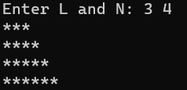

Тест 2 (Отрицательные размеры). Вводим L = -2 и N = 3, программа выводит Error: L and N must be positive:

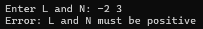

---

## Задание 10. Простые делители числа

### 1. Постановка задачи
Ввести натуральное число n. Найти и вывести все его простые делители без повторений.

### 2. Подход к решению
- Числа меньше или равные единице сразу отбрасываем — у них нет простых делителей.
- Запускаем цикл перебора делителей от d = 2 до n.
- Если число делится на d нацело, выводим d на экран. Так как перебор идет от меньшего к большему, сюда гарантированно попадут только простые делители.
- После вывода делителя запускаем цикл while и делим число n на d до тех пор, пока оно делится без остатка. Это убирает повторы и сокращает число.

### 3. Исходный код
Файл с кодом: [`task10.cpp`](./src/task10.cpp)

### 4. Демонстрация работы

Тест 1. Вводим число 60, программа выводит делители 2, 3 и 5:

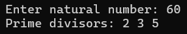

Тест 2. Вводим простое число 13, программа выводит только число 13:

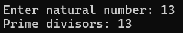

---

## Задание 11. Числа Фибоначчи

### 1. Постановка задачи
Ввести число k. Вывести на экран первые k элементов последовательности Фибоначчи (0, 1, 1, 2, 3, 5, 8 и так далее).

### 2. Подход к решению
- Проверяем, чтобы количество элементов k было строго больше 0.
- Заводим переменные a = 0 и b = 1 типа long long для первых двух чисел ряда.
- В цикле от 0 до k-1 выводим текущее число a, складываем a и b во временную переменную next, после чего сдвигаем значения: в a записываем b, а в b записываем next.
- Решение работает за один проход цикла без применения массивов.

### 3. Исходный код
Файл с кодом: [`task11.cpp`](./src/task11.cpp)

### 4. Демонстрация работы

Тест 1. Вводим число 7, программа выводит первые 7 чисел: Fibonacci: 0 1 1 2 3 5 8:

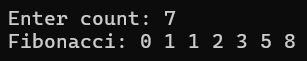

Тест 2 (Некорректное число). Вводим 0, программа выводит сообщение об ошибке:

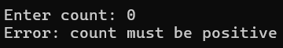
