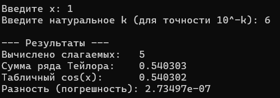
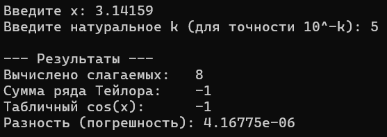
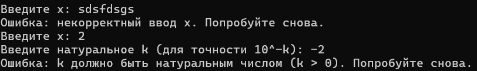
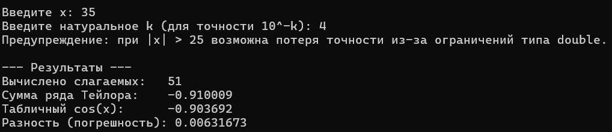

# Лабораторная работа №2: Приближённое вычисление функций с помощью рядов Тейлора

**Вариант 2.9:** Разложение функции cos(x)

---

## 1. Постановка задачи
Вычислить значение функции cos(x) через бесконечный ряд Тейлора с точностью $\varepsilon = 10^{-k}$ (где $k$ — натуральное число):
$$\cos(x) = 1 - \frac{x^2}{2!} + \frac{x^4}{4!} - \frac{x^6}{6!} + \dots$$

**Ограничения и требования:**
- Слагаемые накапливаются в сумме, пока $|\text{слагаемое}| \ge \varepsilon$.
- Запрещено вычислять степени и факториалы отдельными функциями.
- Результат сравнивается со стандартным `std::cos(x)` с выводом разности (погрешности).
- Ввод аргументов валидируется циклом `while (true)`.
- Необходимо определить предел аргумента $x$, при котором сохраняется точность.

---

## 2. Подход к решению

### Рекуррентный расчет слагаемых
Для предотвращения переполнения типов данных факториал и степень отдельно не считаются. Очередное слагаемое получается домножением предыдущего на множитель:
$$\text{множитель} = -\frac{x^2}{(n - 1) \cdot n}$$
Счетчик $n$ стартует с $2.0$ и увеличивается на $2.0$ на каждом шаге (тип `double` исключает переполнение счетчика).

### Предел точности по x (Пункт 6)
Математически ряд сходится на всей числовой оси, но из-за ограничений машинной арифметики (`double`) при $|x| > 25$ промежуточные слагаемые $x^n$ становятся огромными. При сложении чисел с плавающей точкой разных порядков происходит потеря точности (машинное округление), и погрешность резко возрастает. 
Предел корректного счета без приведения к периоду $[-\pi; \pi]$ — диапазон $|x| \le 25$.

---

## 3. Исходный код
Файл с решением: [`task01.cpp`](./src/task01.cpp)

---

## 4. Демонстрация работы

Тест 1 (Базовый угол, точность $10^{-6}$). Ввод: $x = 1$, $k = 6$. Результат совпадает с библиотечным:

Тест 2 (Аргумент в районе $\pi$). Ввод: $x = 3.14159$, $k = 5$. Значение $\cos(x) \approx -1$, погрешность минимальна:

Тест 3 (Валидация). Ввод некорректных символов и отрицательного $k = -2$. Срабатывает повторный запрос:

Тест 4 (Превышение диапазона $x$). Ввод: $x = 35$, $k = 4$. Предупреждение о потере точности, рост погрешности:

