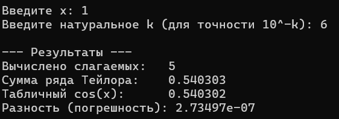
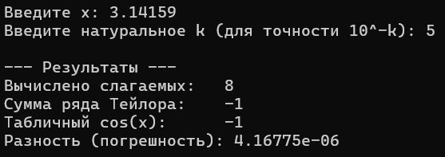
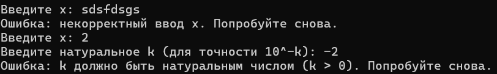
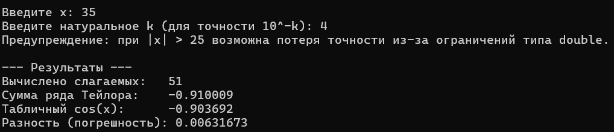

# Лабораторная работа №2: Приближённое вычисление функций с помощью рядов Тейлора

**Вариант:** 2.9 (Разложение функции cos(x))

---

## 1. Постановка задачи
Разработать программу на языке C++ для приближенного вычисления функции cos(x) с помощью бесконечного ряда Тейлора:
cos(x) = 1 - (x^2 / 2!) + (x^4 / 4!) - (x^6 / 6!) + ...

Требования технического задания:
1. Вычисления продолжать до тех пор, пока очередное слагаемое по модулю не станет меньше заданного числа epsilon = 10^(-k), где k — натуральное число.
2. Значения x и k вводятся пользователем с клавиатуры.
3. Очередное слагаемое вычислять методом умножения предыдущего слагаемого на множитель (рекуррентно).
4. Факториал и степень отдельно в функциях не вычислять.
5. Сравнить полученный результат с библиотечной функцией std::cos(x) и вывести абсолютную разность (погрешность).
6. Определить максимальное значение x для корректного вычисления ряда.
7. Использовать бесконечный цикл while (true) для валидации пользовательского ввода.

---

## 2. Подход к решению

Чтобы не вычислять факториал и степень на каждом шаге (что переполнило бы память), каждое следующее слагаемое получается умножением предыдущего слагаемого на дробь:
множитель = - (x * x) / ((n - 1) * n)
Счетчик n увеличивается на каждом шаге на 2 (2, 4, 6, 8...). Счетчик объявлен типом double, чтобы избежать переполнения целых чисел при большом количестве итераций.

### Алгоритм программы
1. Включена поддержка локали setlocale(LC_ALL, ".UTF-8") для корректного отображения кириллицы в консоли.
2. Ввод x и k организован внутри бесконечных циклов while (true) со сбросом потока std::cin, что исключает сбои при вводе букв или некорректных чисел.
3. Точность epsilon вычисляется последовательным делением 1.0 на 10.0 ровно k раз.
4. В цикле while (abs(term) >= epsilon) слагаемые прибавляются к общей сумме, а также подсчитывается их общее количество (count).
5. Результат сравнивается со стандартным значением std::cos(x), после чего выводится величина расхождения (погрешность).

### Определение максимального значения x (Пункт 6 ТЗ)
Математический ряд Тейлора для косинуса сходится при любом значении x. Однако на компьютере с типом данных double при x > 25 промежуточные слагаемые x^n становятся слишком большими числами. При их сложении и вычитании происходит машинная потеря точности, из-за чего погрешность начинает резко увеличиваться.
Вывод: максимальное значение x для вычисления ряда напрямую без приведения угла к периоду составляет x приблизительно равное 25..30. При x > 25 программа выдает предупреждение в консоли.

---

## 3. Исходный код
Файл с кодом программы: [`task01.cpp`](./src/task01.cpp)

---

## 4. Демонстрация работы

Тест 1 (Базовый угол, высокая точность). Вводим x = 1 и k = 6. Сумма ряда совпадает со стандартной функцией cos(x):

Тест 2 (Значение около числа Пи). Вводим x = 3.14159 и k = 5. Значение косинуса близко к -1, разность минимальна:

Тест 3 (Проверка некорректного ввода). Вводим буквы вместо числа и отрицательное k = -2. Программа перехватывает ошибку и повторяет запрос:

Тест 4 (Исследование предела точности x). Вводим x = 35 и k = 4. Срабатывает предупреждение о потере точности, а разность заметно возрастает:

