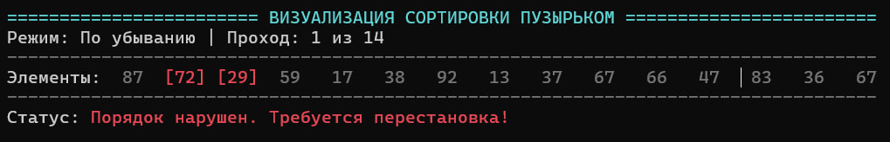
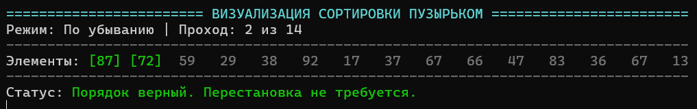
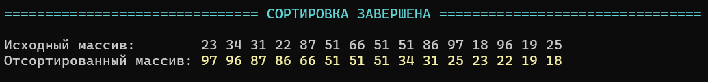
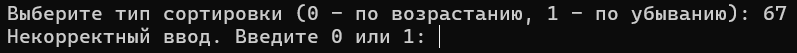

# Лабораторная работа №3: Визуализация сортировки массива методом пузырька

## 1. Постановка задачи

Разработать программу для сортировки одномерного массива целых чисел методом пузырька.

Требования к программе:
1. Пользователь выбирает тип сортировки: по возрастанию (0) или по убыванию (1). Реализовать проверку корректности ввода.
3. Сохранить исходное состояние массива до начала сортировки для последующего сравнения.
4. Реализовать интерактивную пошаговую анимацию процесса сортировки в реальном времени прямо в консоли без мерцания и скроллинга:
   - Сравниваемая пара элементов выделяется цветом: красным — если требуется перестановка, зеленым — если порядок правильный.
   - Пассивные элементы отображаются нейтральным цветом.
   - В верхней части экрана выводится счетчик текущего прохода.
   - В нижней части экрана выводится статусная строка текущего действия.
5. После завершения сортировки вывести на экран исходный и отсортированный массивы.

## 2. Подход к решению

### Алгоритм сортировки
1. Мы идем по массиву слева направо и по очереди сравниваем пары соседних чисел.
2. Если числа стоят в неправильном порядке, меняем их местами с помощью стандартной команды swap.
3. Самые большие (или самые маленькие) числа с каждым проходом «всплывают» в конец массива. Поэтому во внутреннем цикле мы каждый раз проверяем на один элемент меньше ```(n - 1 - i)```, чтобы не тратить время на уже отсортированный хвост.
4. Сделан флаг ```swapped``` (досрочный выход): если за целый проход мы ни разу не поменяли числа местами, значит, массив уже отсортирован — цикл сразу завершается.

### Как сделана анимация в консоли:
1. **Чтобы экран не прыгал и не мерцал:** Обычная очистка экрана через ```system("cls")``` заставляет экран мигать. Вместо этого мы используем специальный код терминала ```\033[H```. Он просто возвращает курсор печати в левый верхний угол экрана, и программа печатает новый кадр прямо поверх старого.
2. **Чтобы старый текст не оставался на экране:** В конце строк выводится код ```\033[K```. Он стирает остатки символов от предыдущего текста, если новое сообщение оказалось короче старого.
3. **Задержка по времени:** Чтобы глаз успевал увидеть подсветку и сравнение чисел, между шагами вызывается функция ```std::this_thread::sleep_for``` из библиотеки *chrono* с паузой в 800 миллисекунд.
4. **Цвета:** Для подсветки используются специальные цветовые коды (ANSI): красный — для ошибки в порядке, зеленый — для верного порядка, бирюзовый — для рамок и золотистый — для финального массива.
5. **Сохранение исходных данных:** Перед сортировкой мы создаем второй массив ```original``` и копируем в него элементы. Алгоритм меняет только рабочий массив a, поэтому в конце мы можем сравнить оба состояния.

> **Примечание по размеру массива:**  
> В программе выбран размер из 15 элементов. Этого достаточно, чтобы наглядно продемонстрировать все этапы сортировки и при этом не загромождать окно терминала.
## 3. Исходный код
Файл с кодом программы: [`task01.cpp`](./src/task01.cpp)

## 4. Демонстрация работы

Тест 1 (Процесс сортировки: обмен элементов). Зафиксирован момент сравнения чисел, когда порядок нарушен: элементы подсвечены красным, статус сообщает о перестановке:



Тест 2 (Процесс сортировки: сохранение порядка). Зафиксирован момент, когда элементы стоят верно: подсветка зеленым цветом, перестановка не выполняется:



Тест 3 (Итоговый результат). Вывод начального массива и полностью отсортированного массива по завершении работы алгоритма:



Тест 4 (Валидация выбора режима). При вводе неверного значения режима программа требует повторить ввод:


