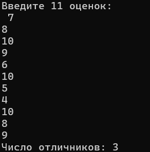
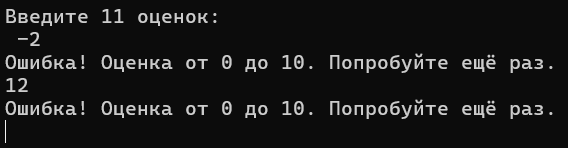
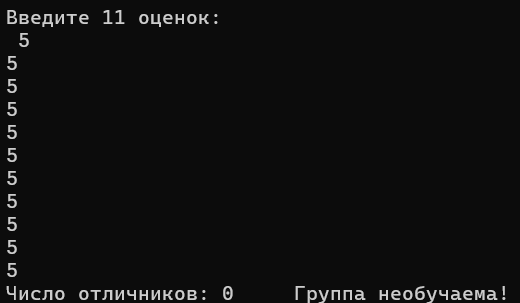

# Лабораторная работа №4: Задача от коллеги по массивам
## 1. Постановка задачи
В группе обучается 11 студентов. Программа должна считывать итоговые экзаменационные оценки (от 0 до 10) с клавиатуры, сохранять их в массив и проверять корректность ввода. Определить количество учащихся, сдавших экзамен на «отлично» (оценка 10). Если число отличников равно 0, вывести сообщение: «Группа необучаема!».

## 2. Подход к решению
- Для хранения данных используется статический массив целых чисел `int students[11]`.
- Ввод элементов организован через цикл `for` с проверкой каждого значения в цикле `while`. Если введено число меньше 0 или больше 10, программа сообщает об ошибке и требует повторить ввод именно для этого элемента.
- Вторым циклом `for` выполняется проход по массиву: если оценка равна 10, переменная-счетчик `count` увеличивается на 1.
- После обработки массива проверяется условие `count == 0`: если отличников нет, в консоль выводится предупреждение.

## 3. Исходный код
Файл с решением: [`2026-09-29_task01.cpp`](./src/2026-09-29_task01.cpp)

## 4. Демонстрация работы

Тест 1 (Есть отличники). Вводим 11 оценок: 7, 8, 10, 9, 6, 10, 5, 4, 10, 8, 9. Программа выводит Число отличников: 3:

Тест 2 (Проверка валидации). Вводим некорректную оценку -2, затем 12. Программа выводит ошибки и ожидает корректного ввода:

Тест 3 (Отличников нет). Вводим оценки без десяток (все 5). Программа выводит Число отличников: 0 и надпись Группа необучаема!:

