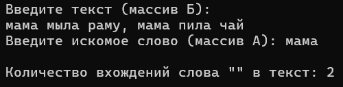
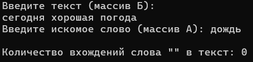
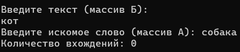

# Лабораторная работа №5: Поиск количества вхождений массива А в массив Б.

## 1. Постановка задачи
Заданы два символьных массива: массив Б (основной текст) и массив А (искомое слово). Разработать алгоритм посимвольного поиска для подсчета суммарного количества вхождений слова А в текст Б без использования встроенных функций поиска.

## 2. Подход к решению
- Для хранения строк используются символьные массивы `char B[1000]` и `char A[100]`. Считывание строк с пробелами осуществляется с помощью `cin.getline()`.
- Длины строк вычисляются функцией `strlen()`. Если искомое слово длиннее основного текста, поиск сразу завершается с нулевым результатом.
- Внешний цикл `for` перебирает начальные позиции `i` в тексте от `0` до `lenB - lenA` (позиции, где слово еще может поместиться).
- Внутренний цикл `for` посимвольно сравнивает символы слова `A[j]` и фрагмента текста `B[i + j]`. При первом несовпадении флаг `match` сбрасывается в `false`, а внутренний цикл прерывается.
- Если все символы фрагмента совпали, счетчик `count` увеличивается на 1.

## 3. Исходный код
Файл с решением: [`2026-10-06_task01.cpp`](./src/2026-10-06_task01.cpp)

## 4. Демонстрация работы

Тест 1 (Несколько совпадений). Текст: "мама мыла раму, мама пила чай", искомое слово: "мама". Программа находит 2 вхождения:

Тест 2 (Слово отсутствует). Текст: "сегодня хорошая погода", искомое слово: "дождь". Программа выводит 0 вхождений:

Тест 3 (Искомое слово длиннее текста). Текст: "кот", слово: "собака". Программа сразу выдает 0:

