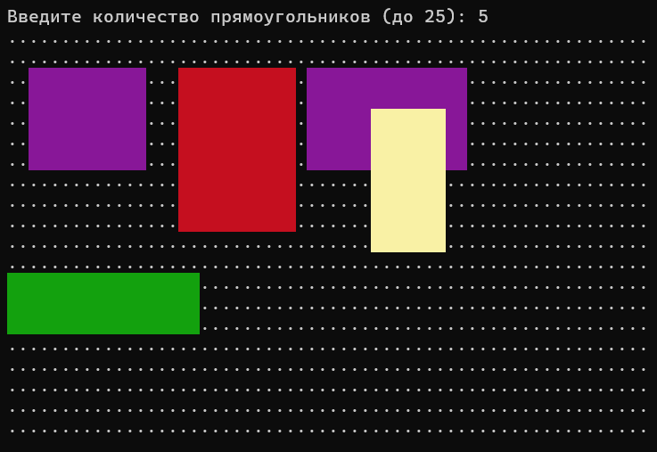
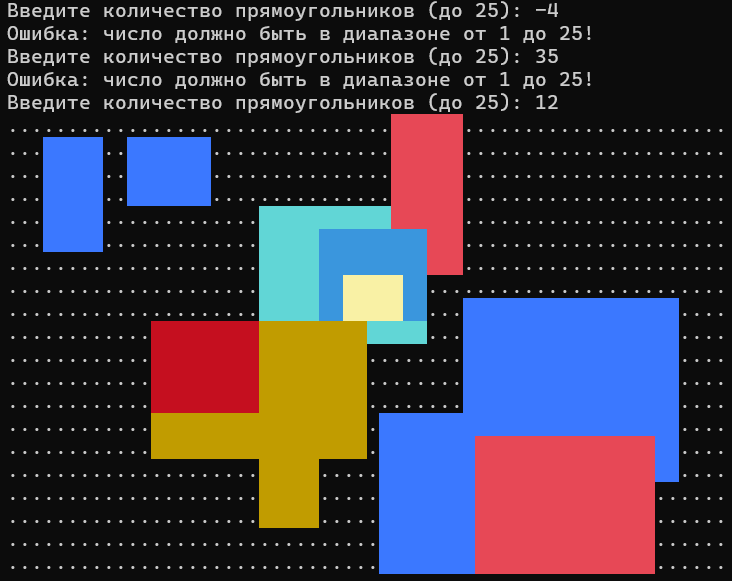

# Лабораторная работа №6: Рисование прямоугольников с помощью двумерных массивов
## 1. Постановка задачи
Создать холст размером 20х60 символов на основе двумерного массива. Пользователь задает количество прямоугольников (от 1 до 25). Программа должна случайным образом сгенерировать размеры, координаты и цвет для каждой фигуры, перенести их на холст и вывести результат в терминал. Фигуры не должны выходить за границы холста; пересекающиеся фигуры должны перекрывать друг друга.

## 2. Подход к решению
- Холст представлен двумерным массивом целых чисел `int canvas[20][60]`. Изначально он заполняется нулями (0 соответствует символу фона `.`).
- Число фигур считывается с валидацией через цикл `while (n < 1 || n > 25)`.
- Для каждой фигуры генерируются:
  - Случайные размеры: ширина от 4 до 18, высота от 2 до 8.
  - Координаты левого верхнего угла по формуле `rand() % (CANVAS_W - w + 1)`, что физически исключает выход фигуры за пределы холста.
  - Цвет заливки из массива ANSI-кодов фона.
- Отрисовка фигуры на холсте выполняется двумя вложенными циклами: цвет текущего прямоугольника записывается в ячейки матрицы, затирая предыдущие значения (эффект перекрытия слоев).
- Перед выводом экран очищается последовательностью `\033[2J\033[H`, после чего пустые клетки выводятся точками, а занятые — цветными пробелами.

## 3. Исходный код
Файл с решением: [`2026-10-06_task02.cpp`](./src/2026-10-06_task02.cpp)

## 4. Демонстрация работы

Тест 1 (Генерация фигур). Вводим количество прямоугольников 5. Программа очищает экран и отрисовывает цветные прямоугольники с взаимным перекрытием:

Тест 2 (Проверка ограничений). Вводим -4, затем 35. Программа отклоняет ввод и запрашивает число повторно до ввода корректного значения:

