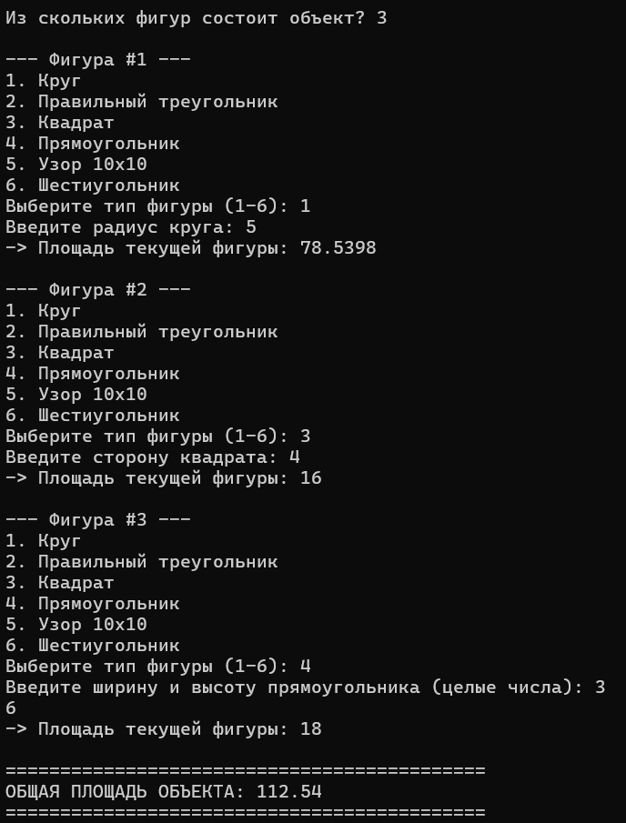
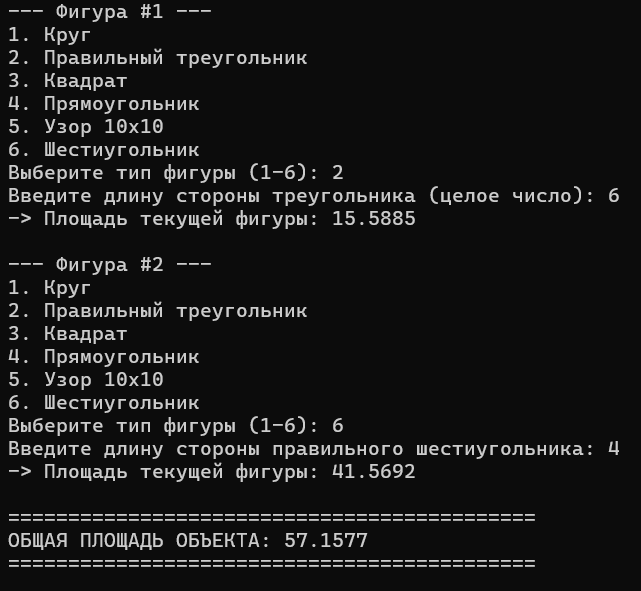
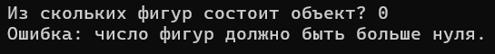

# Лабораторная работа №7: Шаблоны, перегрузка функций и указатели на функции

## 1. Постановка задачи
Разработать программу на языке C++ для расчета общей площади составного объекта. Объект состоит из определенного набора непересекающихся геометрических фигур следующих типов:
1. Круг
2. Треугольник (правильный)
3. Квадрат
4. Прямоугольник
5. Узор 10х10 (матрица; площадь равна сумме единиц)
6. Шестиугольник (правильный)

Обязательные технические требования:
- Вычисление площадей реализовать через перегрузку функций `getArea`.
- Суммирование площадей всех фигур объекта выполнить с помощью шаблона функции.
- Вызов функций обработки фигур организовать через массив указателей на функцию.
- Фигуры не накладываются друг на друга; графический вывод рисунка в консоль не требуется.

## 2. Подход к решению

### 1. Перегрузка функций (Function Overloading)
Созданы функции с одинаковым именем `getArea`, но разными типами и количеством параметров:
- `getArea(double radius, double pi)` — расчет площади круга: S = pi * r^2.
- `getArea(int side)` — расчет площади правильного треугольника: S = (sqrt(3) / 4) * a^2.
- `getArea(double side)` — расчет площади квадрата: S = a^2.
- `getArea(int height, int width)` — расчет площади прямоугольника: S = a * b.
- `getArea(int matrix[10][10])` — расчет площади узора 10х10 (подсчет единиц).
- `getArea(double side, int vertices)` — расчет площади правильного шестиугольника: S = (3 * sqrt(3) / 2) * a^2.

### 2. Массив указателей на функции
Объявлен тип указателя на функцию `typedef double (*FigureFunc)()` и массив `handlers[]`, содержащий адреса 6 функций ввода параметров фигур.  
При выборе пользователем номера пункта меню программа сразу вызывает нужную функцию по индексу: `areas[i] = handlers[choice - 1]()`. Это исключает использование разветвленных конструкций `switch-case`.

### 3. Шаблон функции (Function Template)
Суммирование вычисленных площадей реализовано через шаблон `template <typename T> T sumAreas(T arr[], int size)`. Это позволяет универсально суммировать массивы любого числового типа.

## 3. Исходный код
Файл с решением: [`2026-10-27_task01.cpp`](./src/2026-10-27_task01.cpp)

## 4. Демонстрация работы

Тест 1 (Базовые фигуры: круг, квадрат, прямоугольник).  
- Фигура 1 (Круг): радиус 5 -> площадь 78.5398
- Фигура 2 (Квадрат): сторона 4 -> площадь 16
- Фигура 3 (Прямоугольник): ширина 3, высота 6 -> площадь 18  
Общая площадь объекта: 112.54:

Тест 2 (Многоугольники: треугольник и шестиугольник).  
- Фигура 1 (Правильный треугольник): сторона 6 -> площадь 15.5885
- Фигура 2 (Шестиугольник): сторона 4 -> площадь 41.5692  
Общая площадь объекта: 57.1577:

Тест 3 (Проверка обработки ошибок ввода).  
Ввод нулевого количества фигур (программа завершается с ошибкой), затем при перезапуске выбор некорректного пункта 8 (запрос повторного ввода пункта):

